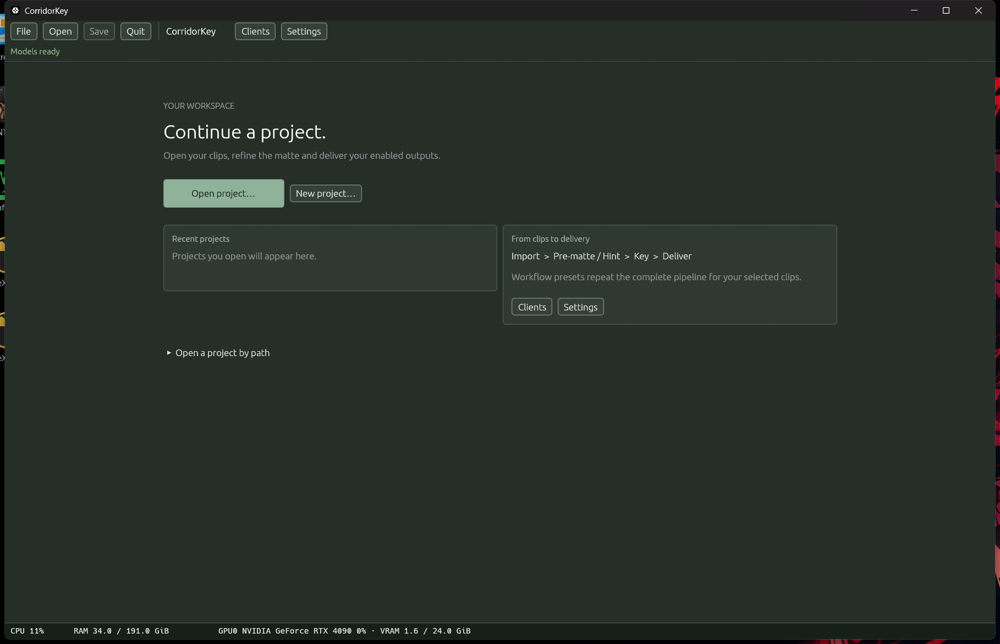

# Keyloom — powered by CorridorKey

Keyloom is a desktop app for pulling clean keys (green or blue screen) from video footage. You bring in clips, build a rough matte (the **hint**), run the keyer, check the result and deliver image sequences or video files. Several computers can share the rendering.

This is the current native app (Windows 10/11 x64 and Linux x64, NVIDIA GPU). The text of the earlier upstream README is kept in [docs/upstream-readme.md](docs/upstream-readme.md).

## Credits and origins

- **CorridorKey and CorridorKey 2.0** were created by **Niko Pueringer / Corridor Digital**. This app uses their keying engine. See the original [CorridorKey](https://github.com/nikopueringer/CorridorKey) and [CorridorKey 2.0](https://github.com/nikopueringer/CorridorKey2.0) projects.
- **EZ-CorridorKey**, created by **Ed Zisk / EZSCAPE ([edenaion](https://github.com/edenaion))**, inspired the accessible desktop workflow and provided the starting codebase for this application's development. See [EZ-CorridorKey](https://github.com/edenaion/EZ-CorridorKey).

The current application has its own native Rust interface, project workflow, network rendering and packaging. It is independently developed; the original authors are credited for their engines, ideas and retained code. Existing licences and attribution notices remain applicable. Engine provenance and local changes are documented in [VENDORED.md](CorridorKeyV2/VENDORED.md), with the [engine licence](CorridorKeyV2/LICENSE) and [third-party notices](CorridorKeyV2/THIRD_PARTY_NOTICES.md).

## What you can do

- **Import** movies or PNG/EXR image sequences into a project, one clip or a whole folder.
- **Build a hint** with SAM (points, boxes, paint), GVM, BiRefNet or a chroma key, then optionally refine it with MatAnyone2 or VideoMaMa, or import an alpha/mask you made elsewhere.
- **Key** with temporal awareness, VRAM and despill controls. Results are never overwritten unless you confirm.
- **Review** Input, Hint, FG, Matte, Comp and Processed in one viewer with an A/B wipe.
- **Deliver** FG, Matte, Comp and Processed as EXR/PNG sequences and/or MP4, MOV or WebM videos.
- **Network setup** from the Clients page: host a network service, join by address and port, or share one optional reusable invitation. Every member sees the other PCs.
- **Batch** many shots at once with a saved workflow preset, and spread them over several PCs on your network.

Download: [Windows installer](https://github.com/NickPittas/Keyloom/releases/tag/v2.3.0-windows) · [Linux installer](https://github.com/NickPittas/Keyloom/releases/tag/v2.3.0-linux). Each release offers online and full offline installers; follow the [installation guide](docs/install.md).

## Quick start

1. [Install](docs/install.md) the app, then download models from **Models & runtime…**.
2. Start Keyloom, choose **New project…**, then **Import clips…**.
3. Work through each clip: **Media → Hint → Key → Review → Deliver**.

Full walkthrough: [User guide](docs/user-guide.md). Rendering on several computers: [Network rendering](docs/network-rendering.md).

## Requirements

- Windows 10/11 (64-bit), or Linux x86-64 with glibc 2.30 or newer (Linux Mint 22.x is the expected target; a clean-machine install has not been tested yet).
- An NVIDIA GPU with a current driver. Everything else (Python, FFmpeg, CUDA runtime, Visual C++ runtime) is bundled; you do not install any toolkit.
- Plenty of disk space. The installer is delivered in slices of up to 1900 MiB, and the full model set is a very large separate download (not bundled).

## Licence and sharing

Keyloom (powered by CorridorKey) is licensed CC-BY-NC-SA-4.0 (non-commercial). The installers and the repository are private: GitHub downloads need you to be signed in with access. Public redistribution of the installers has not been cleared, so please do not share them.
