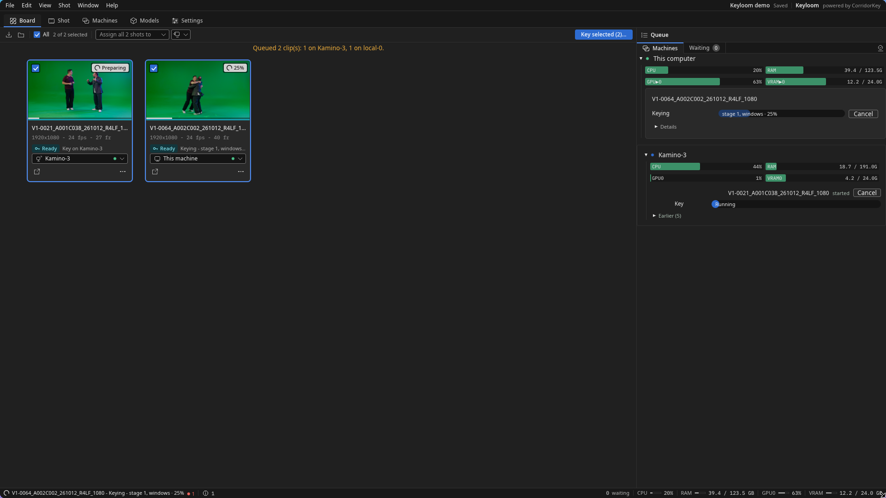
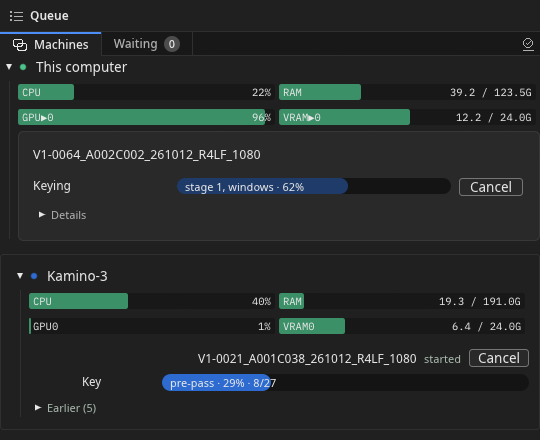
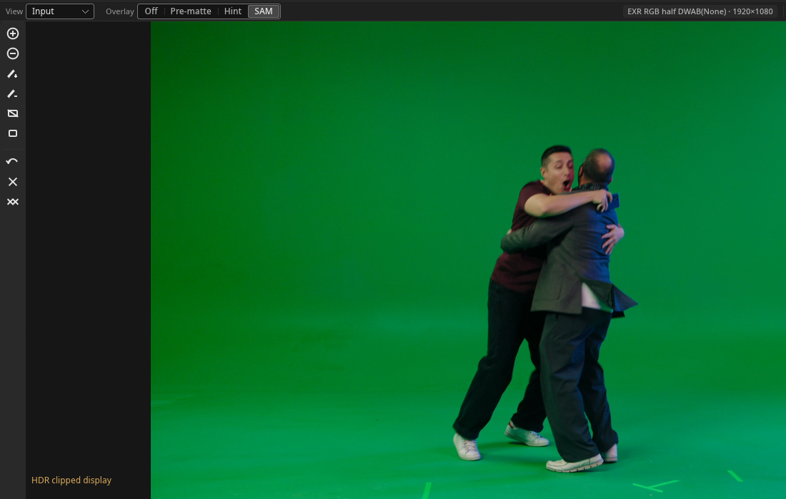
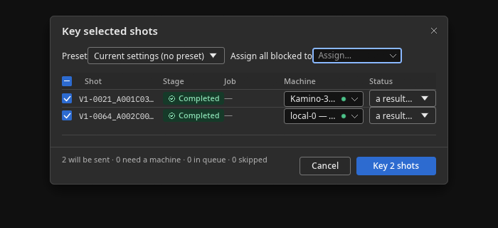
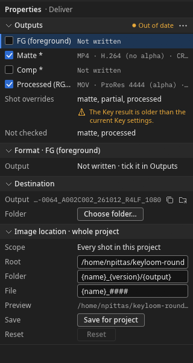
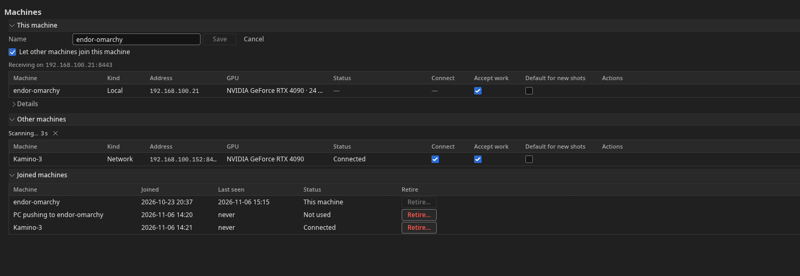
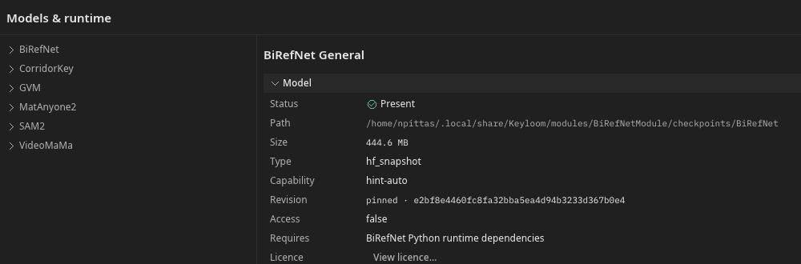
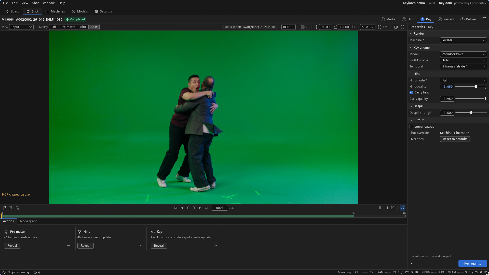
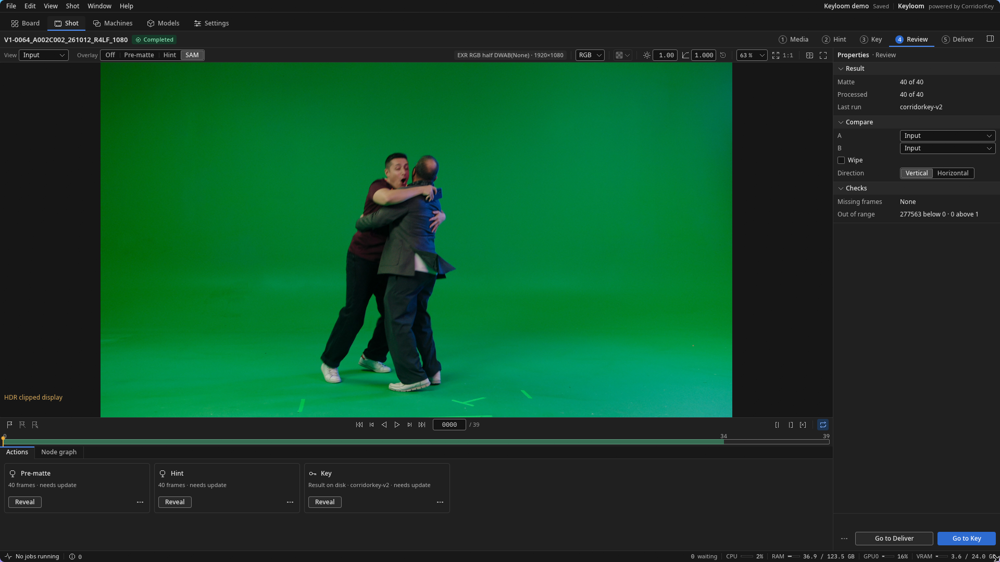

  

<h1 align="center">Keyloom</h1>

  <b>Clean green- and blue-screen keys from video — build a hint, key it, review it, deliver it, and spread the work over every GPU on your network.</b> 
  powered by CorridorKey · Windows 10/11 and Linux x64 · NVIDIA GPU

  <a href="https://github.com/NickPittas/Keyloom/releases/tag/v3.0.0-windows"><b>Download for Windows</b></a> ·
  <a href="https://github.com/NickPittas/Keyloom/releases/tag/v3.0.0-linux"><b>Download for Linux</b></a> ·
  <a href="docs/install.md">Install guide</a> ·
  <a href="docs/user-guide.md">User guide</a> ·
  <a href="docs/release-3.0.0.md">What's new in 3.0.0</a>

  
   The Board — every shot of the project, and a Queue panel showing what each machine is doing, stage by stage.

## See it in action

<table>
  <tr>
    <td width="50%"> <b>One batch, two machines.</b> This PC is keying one shot while Kamino-3 runs another; each shows its stage and progress, with Cancel.</td>
    <td width="50%"> <b>Draw the hint.</b> SAM points, paint, erase and box tools beside the frame, or let GVM, BiRefNet or a chroma key do it.</td>
  </tr>
  <tr>
    <td> <b>Key many shots at once.</b> Pick a machine per shot (or Automatic) and send the whole batch.</td>
    <td> <b>Deliver what you need.</b> FG, Matte, Comp and Processed as EXR/PNG sequences or MP4/MOV/WebM.</td>
  </tr>
  <tr>
    <td> <b>Render on several PCs.</b> Join machines, choose which accept work and which are the default.</td>
    <td> <b>Models in one place.</b> See what is present, Repair a damaged model, or Delete it.</td>
  </tr>
  <tr>
    <td> <b>Key</b> with temporal awareness, VRAM and despill controls.</td>
    <td> <b>Review</b> Input, Hint, FG, Matte, Comp and Processed in one viewer with an A/B wipe.</td>
  </tr>
</table>

Keyloom is a desktop app for pulling clean keys from video footage. You bring in clips, build a rough matte (the **hint**), run the keyer, check the result and deliver image sequences or video files. The text of the earlier upstream README is kept in [docs/upstream-readme.md](docs/upstream-readme.md).

## What you can do

- **Import** movies or PNG/EXR image sequences into a project, one clip or a whole folder.
- **Build a hint** with SAM (points, boxes, paint), GVM, BiRefNet or a chroma key, then optionally refine it with MatAnyone2 or VideoMaMa, or import an alpha/mask you made elsewhere.
- **Key** with temporal awareness, VRAM and despill controls. Results are never overwritten unless you confirm.
- **Review** Input, Hint, FG, Matte, Comp and Processed in one viewer with an A/B wipe.
- **Deliver** FG, Matte, Comp and Processed as EXR/PNG sequences and/or MP4, MOV or WebM videos.
- **Network setup** from the Machines page: discover and connect to other PCs, choose their addresses, and control which PCs accept work.
- **Batch** many shots at once with a saved workflow preset, and spread them over several PCs on your network.

## Quick start

1. [Install](docs/install.md) the app, then download models from **Models & runtime…**.
2. Start Keyloom, choose **New project…**, then **Import clips…**.
3. Work through each clip: **Media → Hint → Key → Review → Deliver**.

**For network rendering, Keyloom must be running on every rendering PC.** Keep its window open, or enable background mode and leave the app running after closing the window. **File → Quit** or terminating the app stops it from receiving work. The separate daemon/service may remain running and keep the PC discoverable, but it cannot render shots or accept them without the app. A visible PC is not necessarily an available renderer.

Full walkthrough: [User guide](docs/user-guide.md). Rendering on several computers: [Network rendering](docs/network-rendering.md). [Documentation index](docs/README.md) distinguishes current guides from historical records and legacy translations.

## Credits and attributions

- **CorridorKey and CorridorKey 2.0** were created by **Niko Pueringer / Corridor Digital**. This app uses their keying engine. See the original [CorridorKey](https://github.com/nikopueringer/CorridorKey) and [CorridorKey 2.0](https://github.com/nikopueringer/CorridorKey2.0) projects.
- **EZ-CorridorKey**, created by **Ed Zisk / EZSCAPE ([edenaion](https://github.com/edenaion))**, inspired the accessible desktop workflow and provided the starting codebase for this application's development. See [EZ-CorridorKey](https://github.com/edenaion/EZ-CorridorKey).

The current application has its own native Rust interface, project workflow, network rendering and packaging. It is independently developed; the original authors are credited for their engines, ideas and retained code. Existing licences and attribution notices remain applicable. Engine provenance and local changes are documented in [VENDORED.md](CorridorKeyV2/VENDORED.md), with the [engine licence](CorridorKeyV2/LICENSE) and [third-party notices](CorridorKeyV2/THIRD_PARTY_NOTICES.md).

### Model creators and download terms

**Model weights are not bundled with either installer.** The online installers download runtime dependencies; after installation, Keyloom's model manager downloads the models you select from their creators' published repositories or storage endpoints (including Hugging Face and GitHub), or reuses verified files you already have. The pinned sources are recorded in the [model catalog](backend/model_catalog.json).

**Each model's use is governed by its creator's own licence and terms**, including any non-commercial, access or redistribution restrictions. Code and weights may have different licences. Keyloom's licence does not replace those terms, grant extra rights or imply endorsement. Review the terms for the exact model/version before downloading or using it.

| Model / component | Creator or publisher | Sources and applicable notices |
|---|---|---|
| CorridorKey 2.0 and its weights | Niko Pueringer / Corridor Digital | [Model source](https://huggingface.co/nikopueringer/CorridorKey2.0), [Corridor Key Licence v2](CorridorKeyV2/LICENSE) |
| SAM 2.1 | Meta / Segment Anything authors | [Project and licence](https://github.com/facebookresearch/sam2), [model sources](https://huggingface.co/facebook/sam2.1-hiera-large) |
| GVM | AIM research team, Zhejiang University | [Project](https://github.com/aim-uofa/GVM), [weights](https://huggingface.co/geyongtao/gvm), [retained notice](gvm_core/LICENSE.md) |
| BiRefNet variants | BiRefNet authors (ZhengPeng7) | [Project and licence](https://github.com/ZhengPeng7/BiRefNet), [model sources](https://huggingface.co/ZhengPeng7) |
| MatAnyone2 | MatAnyone2 authors (pq-yang) | [Project and model releases](https://github.com/pq-yang/MatAnyone2), [retained S-Lab notice](modules/MatAnyone2Module/LICENSE.txt) |
| VideoMaMa | CVLAB, KAIST | [Project](https://github.com/cvlab-kaist/VideoMaMa), [weights](https://huggingface.co/SammyLim/VideoMaMa), [retained notice](VideoMaMaInferenceModule/LICENSE.md) |
| Stable Video Diffusion (VideoMaMa dependency) | Stability AI | [Model source and terms](https://huggingface.co/stabilityai/stable-video-diffusion-img2vid-xt) |
| C-RADIOv4-SO400M (foundation model) | NVIDIA | [Model source and terms](https://huggingface.co/nvidia/C-RADIOv4-SO400M), [retained notice](CorridorKeyV2/THIRD_PARTY_NOTICES.md#c-radiov4-so400m) |
| MoGe-2 ViT-B (foundation model), with DINOv2 code | Microsoft / MoGe authors; Meta for DINOv2 | [Project](https://github.com/microsoft/MoGe), [weights](https://huggingface.co/Ruicheng/moge-2-vitb-normal), [retained notices](CorridorKeyV2/THIRD_PARTY_NOTICES.md#moge-2-vit-b) |
| RVM — Recurrent Video MAE (foundation model) | Google DeepMind | [Project](https://github.com/google-deepmind/representations4d), [code/weight notices](CorridorKeyV2/THIRD_PARTY_NOTICES.md#rvm-recurrent-video-mae-small) |

These credits do not resolve discrepancies between upstream licence labels and retained licence texts (notably MatAnyone2); consult both the linked source and retained notices rather than assuming a permissive or commercial-use grant.

## Requirements

- Windows 10/11 (64-bit), or Linux x86-64 with glibc 2.30 or newer (Linux Mint 22.x is the expected target; a clean-machine install has not been tested yet).
- An NVIDIA GPU with a current driver. Python and FFmpeg are bundled; missing public runtime dependencies are downloaded by the online installer. You do not need to install a CUDA development toolkit. Model weights are downloaded separately under their creators' licences.
- Plenty of disk space. Keep the Windows installer's `.exe` and `.bin` slice together. The full model set is a very large separate download (not bundled).

## Licence and sharing

Keyloom (powered by CorridorKey) is licensed CC-BY-NC-SA-4.0 (non-commercial). Retained engines and third-party components remain subject to their respective licences and notices.

This source repository is public, and installer assets have already been published on the linked GitHub releases. Their public availability does not establish permission to redistribute the bundled installers or imply approval or endorsement by Corridor Digital or other upstream authors.

Public redistribution of the bundled installers has not been cleared. Please do not redistribute them unless the required permissions and compliance with all applicable component licences have been confirmed.
