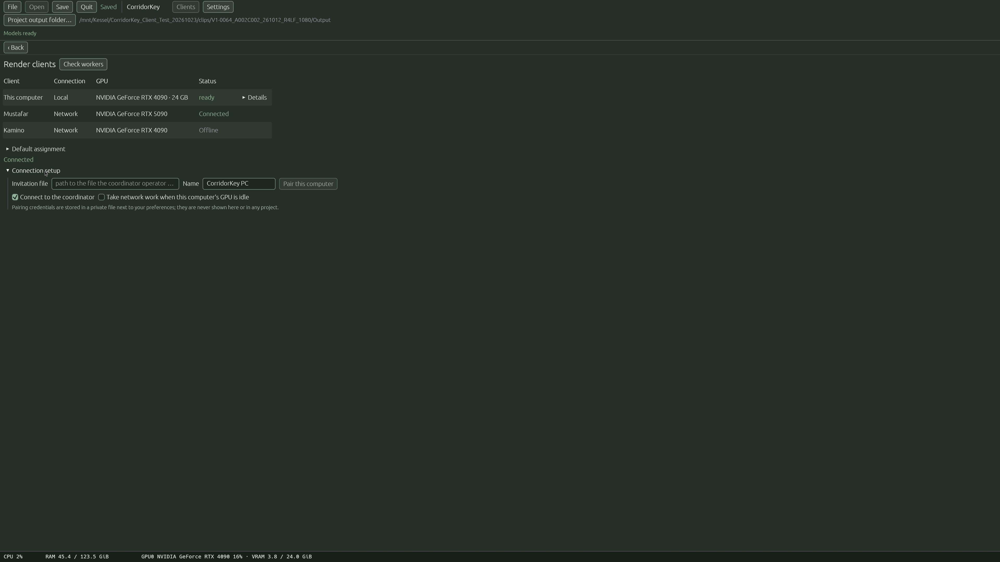
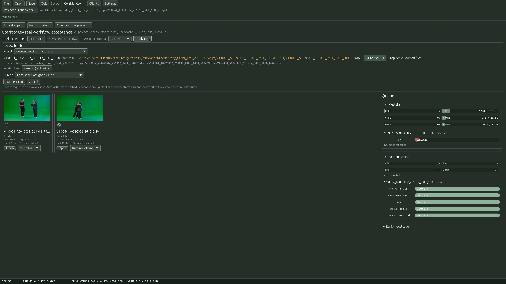

# Network rendering

You can spread a batch over several computers, Windows and Linux mixed. Each computer runs its own CorridorKey and its own GPU; one computer also acts as the **coordinator** that hands out work. The footage and results live on **shared storage** (a NAS or file server) that every computer can reach.

What this is and is not:

- **One GPU per installation.** Computers do not pool GPUs into one bigger one.
- Whole shots are sent to a PC. A single shot is not split across PCs.
- Only **new** results are sent over the network. **Resume** and **Replace** stay on the computer that owns the shot, and movies or external sources are not supported for network jobs.
- Hint, Key and Deliver for a network shot run on the receiving PC. Each receiving PC checks that its models match before it accepts work.

## Before you start

On **every** computer:

1. CorridorKey [installed](install.md), models Ready (see **Settings → Models & runtime…**).
2. A real, interactive sign-in to the same user account you run CorridorKey with. Sign in at the desktop or via remote desktop; SSH alone does not give you your mapped drives.
3. The shared storage reachable: a Linux mount (for example `/mnt/Kessel`), a Windows mapped drive (for example `R:\` or `Y:\`), or a UNC share (`\\server\share`).

On the coordinator computer, one that is normally on, pick a stable address (a DNS name or fixed IP) that all other computers can reach, and allow the coordinator's TCP port (default `8443`) through the firewall yourself; CorridorKey creates no firewall rules.

## 1. Run the coordinator

The coordinator is started from a terminal with the `corridorkey-coordinator` command from the install:

- Linux: `~/.local/opt/CorridorKey/bin/corridorkey-coordinator`
- Windows: `%LOCALAPPDATA%\Programs\CorridorKey\bin\corridorkey-coordinator.cmd`

Start it with:

```sh
~/.local/opt/CorridorKey/bin/corridorkey-coordinator serve \
  --state-dir ~/corridorkey-coordinator \
  --host 0.0.0.0 --port 8443 \
  --advertise-host kessel.lan \
  --invite-out ~/invites/invite-edit-bay-2.json
```

On Windows, use PowerShell (replace `kessel.lan` with your coordinator's stable reachable address):

```powershell
& "$env:LOCALAPPDATA\Programs\CorridorKey\bin\corridorkey-coordinator.cmd" serve `
  --state-dir "$env:LOCALAPPDATA\CorridorKey-Coordinator" `
  --host 0.0.0.0 --port 8443 `
  --advertise-host kessel.lan `
  --invite-out "$env:USERPROFILE\invite-edit-bay-2.json"
```

- `--state-dir` is where the coordinator keeps its database and its certificate. **Always use the same folder on a local disk, never on the NAS.** It keeps previously paired computers working.
- `--advertise-host` is the name or address other computers will use. It is built into the certificate, so keep it stable. If it changes, clients cannot verify the server.
- Without `--invite-out` it listens but cannot pair anyone new. Without `--host` it only listens on the machine itself (loopback).
- The command prints `invitation written to … (expires in 10 minutes)`, then `listening on https://…`. Leave it running.

### One invitation per computer

Today an invitation can only be created **when the coordinator starts**. To add a computer:

1. Make sure nothing important is running through the coordinator (stopping it interrupts network jobs; do this when it is idle).
2. Stop the coordinator (`Ctrl+C`).
3. Start it again with the **same** `--state-dir` and `--advertise-host`, and a **new unique file** after `--invite-out`, for example `invite-pc2.json`.
4. Move that file to the new computer over a channel you trust (USB stick, or a copy you can verify). It is a private file; it is created readable only by you.

An invitation works **once** and for **10 minutes**. If it expires or fails, restart the coordinator for a new file. Do not share one invitation between PCs.

To remove a computer: stop the coordinator, run `corridorkey-coordinator revoke --state-dir <dir> <installation id>`, then start it again. You need that computer's installation id (it starts with `inst_`). On that PC, find the preferences folder in **Settings → Paths and info**, then read only `installation_id` from `network/credentials.json` beside the preferences file. Never share the token or the whole credentials file. Use the full coordinator command path shown above if it is not on your PATH.

## 2. Map the shared storage

Different computers see the same storage under different paths. CorridorKey sends jobs using a **logical name** plus a relative path, and each PC turns that into its own local path.

On each PC open **Settings → Path mapping** and add a shared location:


| Field | Example on Linux | Example on Windows |
|---|---|---|
| **Shared location name** | `SharedStorage` | `SharedStorage` |
| **Folder on this PC** | `/mnt/Kessel` | `R:\` or `\\kessel\media` |

- The **name must be identical** on every PC. Use the same logical name everywhere.
- Press **Test read and write**. It must report *Read: OK* and *Write: OK*.
- **Apply settings** to save. Invalid names or non-absolute paths block Apply. A saved mapping can still be unavailable: check the read/write result before sending work and reconnect the share in this user session if needed.

The mapped root must cover both your **project source** and your **outputs**. If your project is in `/mnt/Kessel/Shows/A` and renders go to `/mnt/Kessel/Renders`, the one `/mnt/Kessel` mapping covers both. If sources and outputs live on different shares, add a location for each.

## 3. Pair each computer

On the computer you are adding, put the invitation file somewhere private, then open **Clients**:


Under **Connection setup**:



1. **Invitation file** – the full path to the file you copied.
2. **Name** – a clear name, for example `Edit bay 2`.
3. Press **Pair this computer**. The status line changes to *Pairing…*.
4. Tick **Connect to the coordinator**. The status should read *Connected*.
5. To let this computer **work** for others, also tick **Take network work when this computer's GPU is idle**. Leave it off on a PC you only use to send work.

The pairing credentials are stored in a private file next to your preferences and are not shown in the app or saved in projects.

The **Clients** page also shows availability only: each computer, its GPU, and *Connected* or *Offline*. **Check workers** re-tests the workers on this computer. Progress and load are shown in the Batch queue, not here.

Keep CorridorKey running for a PC to take work. Use [background running](user-guide.md#background-running) (**Keep running when the window is closed** and **Start in the background when I sign in**), so a closed window or a reboot does not take the PC out of the pool. It starts at **sign-in**, not at boot, and for the same user whose drives are mapped.

## 4. Send work

### Pick a PC for each shot

On the batch board, tick the clips and choose **Assign selected to** a computer (or *Automatic*) and press **Apply to N**. You can also choose a **Render client** per shot on the clip's Key or Deliver page. A shot assigned to a PC that is currently offline keeps that assignment; it is not silently moved elsewhere.

### Review and confirm

Select clips, choose a **Preset** and press **Key selected N clips…**. On **Review batch**:



- Only **new** results can be sent. Resume or Replace shots must use the local computer.
- Each shot shows its **Render client**.
- **Run on** chooses for the whole batch: **Each shot's assigned client**, **Network: any available client**, or **Network: <PC name>** for one named PC. This overrides the per-shot choice for this batch only.
- Each shot is sent whole (Hint → Key → Deliver as reviewed).
- **Queue N clips** starts the work.

Per-shot settings carry over from your preset, but **a shot's own In/Out, source colour and hint prompts are not copied from the preset**; each shot keeps its own.

### Watch progress


This queue screenshot is from the earlier real two-PC run, reused here without submitting another render.

The **Queue** panel groups jobs by the PC that owns them. Each job shows its stages (**Pre-matte, Hint, Keying, Export**), progress per stage, and the PC's **CPU, RAM, GPU and VRAM** bars. **Cancel** is cooperative: the worker stops at a safe point and keeps frames already written. A PC that is not connected shows **Offline**.


## Troubleshooting

| Symptom | What to check |
|---|---|
| *Not connected* after pairing | Coordinator running? Firewall open for its port? `--advertise-host` still the same name? |
| Pairing fails | The invitation expired (10 minutes) or was already used. Restart the coordinator with a new `--invite-out` file. |
| *Connect to the coordinator in Clients first* | The PC is not connected. Open **Clients** and tick **Connect to the coordinator**. |
| A shot is refused on the receiving PC | Path mapping missing or not identical, or the shared drive is not mounted for that signed-in user. Use **Test read and write**. |
| Models differ | The receiving PC refuses work if its models do not match this PC's. Run **Verify all** or `corridorkey-setup status --verify`. |
| Nothing picks up work | **Take network work when this computer's GPU is idle** must be ticked on that PC, and its GPU must be idle. |
| Mapped drive missing | Background running only works for the same user who maps the drive. Sign in interactively first; SSH does not provide it. |

To release a job from a PC that died, stop the coordinator and use `corridorkey-coordinator abandon --state-dir <dir> --reason "…" --i-understand-writer-not-stopped <attempt id>` only after checking that machine; it marks the job failed and does **not** stop the process or unlock anything.
