# Keyloom user guide

Screenshots show the native app. Clients and queue captures use clearly labelled, isolated example data. Some other workflow captures predate the Keyloom rename; use the accompanying text for current control names. Example hardware readings are not performance measurements.

This guide follows one shot from import to delivery, then covers batches, settings and models. For rendering on several computers see [Network rendering](network-rendering.md).

Contents: [Start](#1-start-a-project) · [Import](#2-import-clips) · [Batch board](#3-the-batch-board) · [Media](#4-media) · [Hint](#5-hint) · [Key](#6-key) · [Review](#7-review) · [Deliver](#8-deliver) · [Batches](#9-key-many-shots-at-once) · [Settings](#10-settings) · [Models](#models) · [Keys](#keyboard-shortcuts)

## 1. Start a project

On first launch you see the welcome screen.

- **Open project…** opens an existing project folder.
- **New project…** creates an empty project.
- **Recent projects** lists projects you opened before. A missing folder is shown as *Missing*.
- **Open a project by path** lets you paste a folder path.

The same commands are in the **File** menu (**New project…**, **Open project…** `Ctrl+O`, **Save project** `Ctrl+S`, **Quit** `Ctrl+Q`). The top bar shows **Saved** or **Unsaved**. Most edits are saved as you make them; **Save project** also stores your workspace (open clip, page, view, frame).

### New project

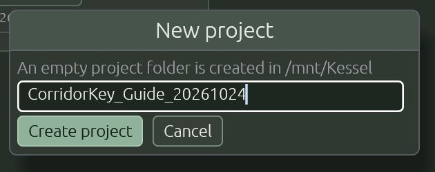

Choose a parent folder, then give the project a name in the **New project** window and press **Create project**. An empty project folder is created inside the folder you picked.

### Project output folder

The bar under the menu shows **Project output folder…**. New renders go under this folder. Existing outputs stay where they are. With nothing set, each clip uses its own default output folder.

## 2. Import clips

Use **Import clips…** (movies, several at once), **Import folder…** (movies plus image sequences found in the folder and its sub-folders), or drag files and folders onto the window. On Linux, drag and drop needs X11 (the app starts through XWayland when it can).

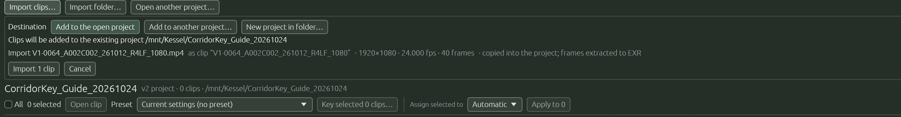

Nothing is written until you press **Import N clips** in the plan. The plan lists each clip, what happens to it, and any file that is skipped and why. The **Destination** section shows exactly where the files will go:

- **Add to the open project**
- **Add to another project…**
- **New project in folder…** (the new project folder is `<chosen folder>/<yymmdd_hhmmss>_<name>`)

What import does:

- Movies are **copied into the project** and their frames are extracted to EXR.
- PNG and EXR **image sequences are referenced in place**; your source folder is never changed. JPEG, TIFF and DPX sequences are refused.
- **Cancel import** stops after the current step. A movie that was not finished keeps its copy and shows **Resume** on its card.

## 3. The batch board

Opening a project shows the batch board; import may open the new clip directly. Use **Back to batch** to return.

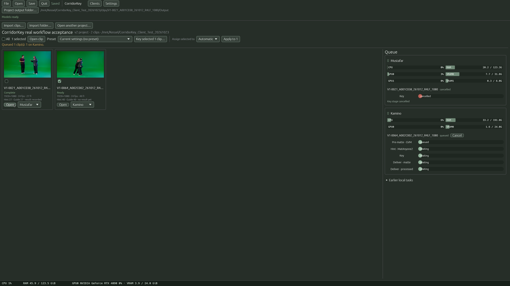

This isolated example uses simulated media, a running pipeline and three waiting shots.

- One card per clip, with thumbnail, name, range and a summary of what exists (frames, hint, results).
- **All** and the per-clip checkboxes select clips; **Assign N selected to** shows the selection count.
- **Open** on a card opens that clip (it needs frames).
- **Assign N selected to** + **Apply to N** choose which computer renders the selected clips (see [Network rendering](network-rendering.md)).
- **Preset** and **Key selected N clips…** start a batch (see [section 9](#9-key-many-shots-at-once)).
- The **Queue** panel on the right has **Machines** and **Waiting (N)** tabs. Each PC keeps completed runs under **Earlier (N)**; see [queue controls](#queue-machines).
- **Import clips…** and **Import folder…** add media. Use **File → Open project…** to switch projects; missing source media has relink/recovery actions.
- **Clients** and **Settings** are in the top bar.

## 4. Media

Open a clip. The workspace has five pages above the viewer, **Media · Hint · Key · Review · Deliver** (keys `1`–`5`). A node graph shows the chain Media → Pre-matte → Hint → Key → outputs; click a node to jump to its page. **Properties** holds the settings of the page; **Focus (F)** enlarges the viewer; `G` shows or hides the graph.

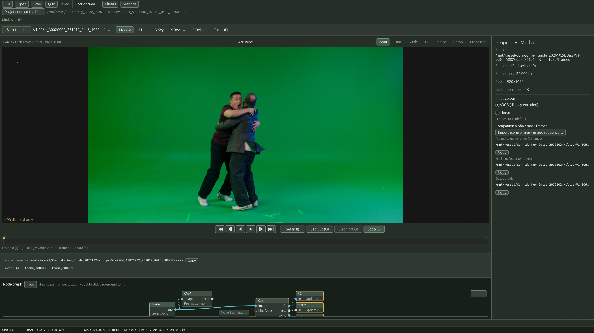

The viewer is shared by all pages: mode chips in the top right (**Input, Hint, Guide, FG, Matte, Comp, Processed**), **A/B wipe** at the top, transport and a scrubbable timeline below.

On the Media page:

- **In/Out range:** press `I` and `O` (or use Set In / Set Out) on the frame you want. Everything that follows (hint, Key, delivery) is confined to this range. If you set nothing, the whole clip is used.
- **Input colour** (in Properties): tell Keyloom whether the frames are **Linear** or **sRGB**. Check it; it changes the result.
- **Extract frames from this movie** if extraction has not finished.
- **Relink movie…** or **Relink missing footage…** if the source moved. The size, rate and frame count are checked first; a partial match needs your confirmation.
- **Import alpha or mask image sequence…** brings in a companion matte as **Alpha hint (AlphaHint)** or **Mask (VideoMamaMaskHint)** (PNG/EXR, same names as the frames).

## 5. Hint

The hint is a rough matte that tells Key what is foreground. It has two stages: the **Pre-matte** (a first guess) and the **final Hint** (optionally refined).

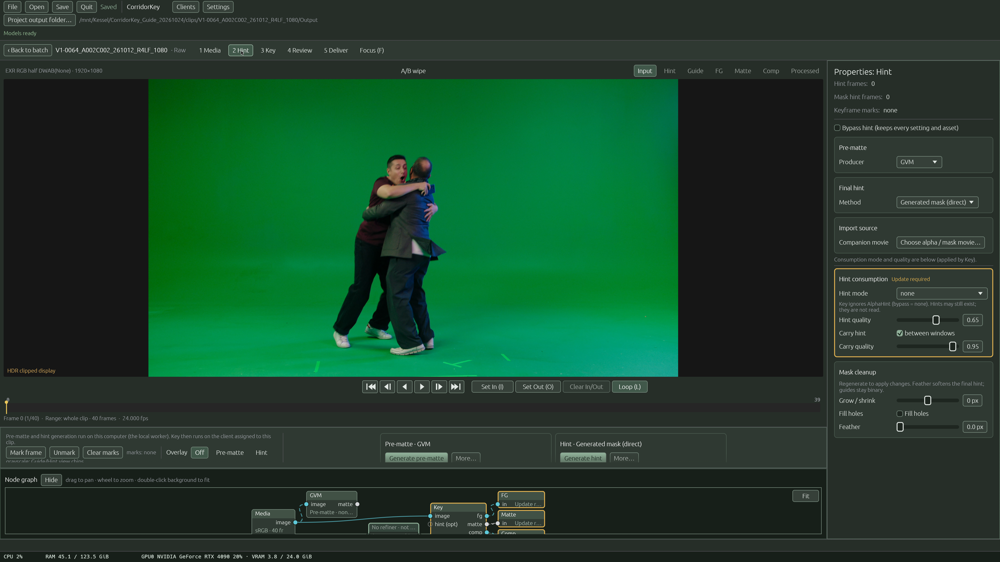

**Pre-matte** (`Producer`):

| Producer | How it works |
|---|---|
| SAM | Add points, a box or paint on the frame (**Brush** size in Properties). **Preview frame** shows the result without writing; **Track prompts** follows them across the In/Out range. |
| GVM | Automatic. **Generate pre-matte**. |
| BiRefNet | Automatic; choose the variant. **Generate pre-matte**. |
| Chroma key | Pick **Green** or **Blue**, optionally pick the screen colour on the frame, adjust **Strength**, **Clip black/white**, **Shrink / grow**, **Edge blur**. |

**Final hint** (`Method`):

| Method | How it works |
|---|---|
| Generated mask (direct) | The pre-matte is used as the hint as is |
| MatAnyone2 | Refines the pre-matte over the range (seeded from its first frame) |
| VideoMaMa | Refines the pre-matte in chunks (**Chunk size**) |
| Imported alpha | Use a matte you imported; **Choose alpha / mask movie…** then **Import movie** |

Press **Generate hint** to produce it. Other controls:

- **Mark frame / Unmark / Clear marks** place sparse keyframe marks (used by Key's keyframe mode). **On marked frames** (under **More…**) generates only on marks.
- **Overlay**: Off, Pre-matte or Hint on the viewer.
- **Mask cleanup**: **Grow / shrink**, **Fill holes**, **Feather**.
- **Bypass hint** keeps every setting and asset but tells Key not to use the hint.

The previous hint stays in place until the new one is complete. Generating only touches frames inside In/Out.

Companion alpha/mask *movies* are imported here (**Choose alpha / mask movie…**); companion *sequences* are on the Media page.

## 6. Key

Key creates the final foreground, matte, comp and processed images from your frames and hint.

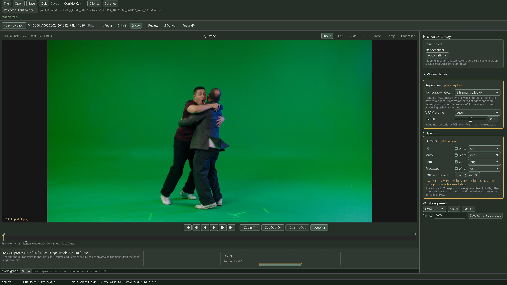

The Key settings are in Properties:

- On **Hint → Hint consumption**: **Hint mode** (none / full / keyframes), **Hint quality**, **Carry hint** between windows, **Carry quality**.
- **Key engine:** **Temporal window** (Auto, 80/40, 48/24, 24/12, 8/4, Off 1/1; each shows a plain explanation), **VRAM profile**, **Despill**.
- **Outputs:** **FG, Matte, Comp, Processed**, each with a **Write** checkbox and format (**exr** or **png**), plus **EXR compression**. DWAB is lossy; use piz, zip or none for exact data.
- **Render client:** which computer runs the job (see [Network rendering](network-rendering.md)).

Start with **Key clip**. Progress and **Cancel** appear in the same place. Choose **Force stop worker** only if Cancel does not respond; frames already written stay.

### New, Resume and Replace

Key never overwrites a result silently. If the clip already has one, open **Output & result actions**:

| Action | When |
|---|---|
| **Key as vNNN / Write as vNNN** | Same settings, next free version folder. Needs `{version}` in the folder template (Deliver). |
| **Resume previous run** | Finish an interrupted local run. Not available when the pipeline regenerates the hint. |
| **Replace result (N files)** | Overwrite only the files that result owns, after you confirm **Yes, replace**. Old files stay until the new ones are verified. Local only. |

If a previous run left a lock (for example after a crash), the same section explains it and offers a confirmed release.

## 7. Review

The Review page is for inspecting what you got. Use the viewer:

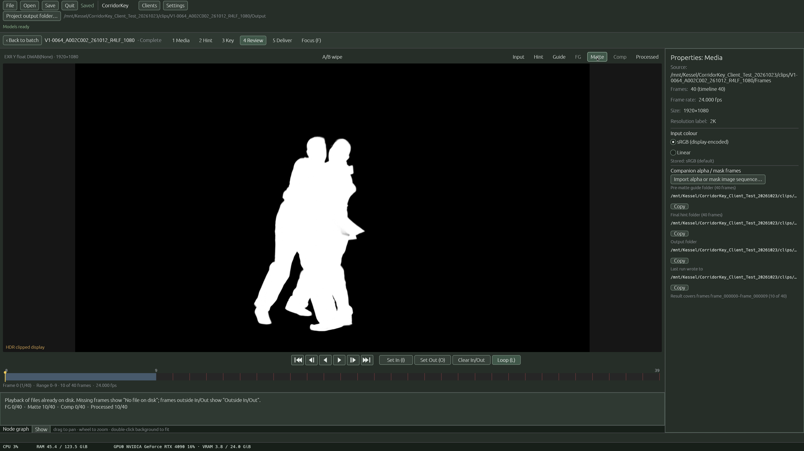

- Mode chips: **Input**, **Hint**, **FG**, **Matte**, **Comp**, **Processed**.
- **A/B wipe** compares two views (pick the second view in the box next to it). Drag the divider.
- `Space` play, `←/→` step (hold `Shift` for 10), `Home/End`, `L` loop, wheel or `+` `-` zoom, `0` fit.
- Missing frames show *No file on disk*; frames outside your range show *Outside In/Out*.
- HDR values above the display range are clipped for display and flagged.

## 8. Deliver

Each enabled output (FG, Matte, Comp, Processed) has its own card.

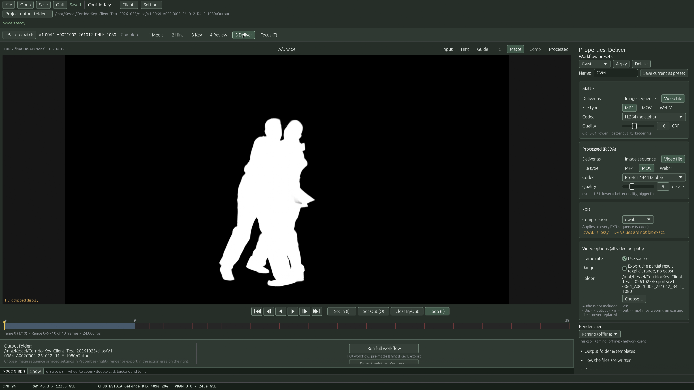

- **Deliver as:** **Image sequence** or **Video file**.
- For a video: **File type** **MP4** (H.264 or H.265/HEVC, no transparency), **MOV** (ProRes 422 or ProRes 4444, keeps alpha) or **WebM** (VP9, keeps alpha), plus a **Quality** setting per output.
- **Video options:** **Frame rate** (**Use source**), **Range** (**Export the partial result**), **Folder** (**Choose…** or **Project default**).
- **Compression** applies to all EXR sequences.
- **Run full workflow** runs this shot's whole pipeline: pre-matte → hint → Key → every enabled video. It asks before re-running if results exist.
- **Export existing Key result** encodes your videos from the current Key result **without** running Key again.
- Videos have no audio. File names are `<clip>_<output>_<in>-<out>.<mp4|mov|webm>`, and an existing file is **never** replaced.
- **Save output location** / **Reset to default** edit where results go (root, folder template and file template).

**Save current as preset** (in the preset area; type a **Name**) stores your Hint, Key and Deliver choices for batches.

## 9. Key many shots at once

On the batch board:

1. Tick the clips.
2. Choose a **Preset** (or **Current settings (no preset)**) when presets are available.
3. Choose **Automatic** or a particular PC using each clip's assignment menu. To change several at once, use **Assign N selected to** and **Apply to N**; **All** selects every clip.
4. Press **Key selected N clips…**. Keyloom checks the shots and queues them directly when no decisions are needed.

If a decision is needed, **Review batch** lists the affected clips. Existing results offer a new version rather than overwriting them: choose **OK** to accept the proposed action or **Skip** to leave a shot out, then **Queue N clips**. Blocked clips show the reason and cannot be accepted until it is fixed. Where a preset conflicts with a shot's own settings, **Use preset values** takes the preset instead.

Each shot keeps its own In/Out, input colour and hint prompts. SAM and Chroma pre-mattes must already cover the clip's frames; otherwise the shot is blocked. GVM and BiRefNet generate theirs automatically.

### Clients and assignment

Open **Clients** in the top bar to manage PCs, not to monitor renders.

**Keep Keyloom running on every rendering PC**, with its window open or in configured background mode. A PC whose app has quit can still be found because its daemon/service is running, but it will not receive work or render shots. **File → Quit** stops the app; closing its window is different when background mode is enabled. See [background running](#background-running).

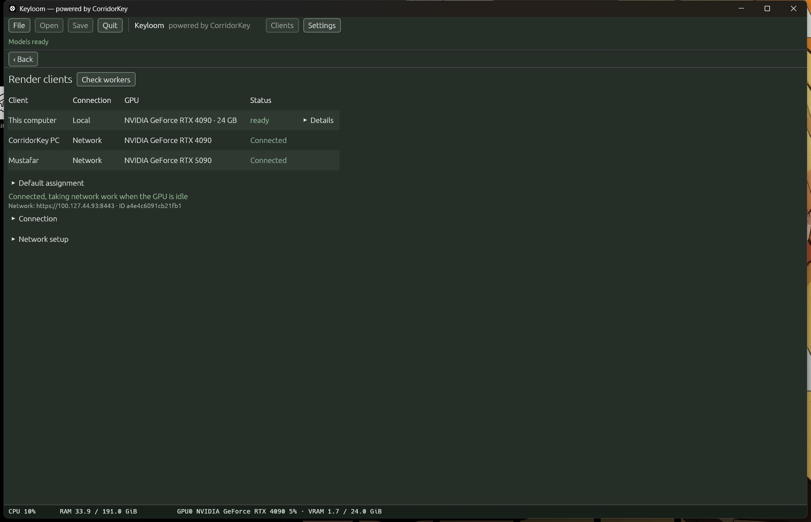

*Isolated documentation example with simulated PCs, addresses and hardware.*

- **This PC** shows service controls, **Let other PCs join this PC**, and the name other PCs see.
- **Other PCs** shows newly discovered PCs. Tick one to join it; it then moves into the **Clients** table.
- The **Clients** table combines this computer and joined PCs, with their addresses, status and reported GPUs. **Connect** enables a connection. **Accept work** allows Automatic to send to a network PC; on this computer's own connection it enables receiving from other PCs.
- **Check workers** probes local workers. **Default assignment** sets the session's placement; individual clips can override it.
- **Default for Batch job** selects a preferred network for submissions without a specific PC, not a fixed destination for every Automatic shot.

See [Network rendering](network-rendering.md) for setup, address selection, access controls and shared-path mapping.

### Queue: Machines

*Isolated example: one simulated pipeline is running, with three shots still waiting for a PC. Hardware readings are example values, not measured performance.*

The **Queue** panel groups assigned work by computer. In **Machines**, expand a PC to see CPU, RAM, GPU and VRAM meters and its current shots. Collapse it to keep the current shot and overall status in the header.

Each pipeline shows its applicable stages in order: **Pre-matte**, **Hint**, **Keying**, **Export**, with progress and cancellation controls. **Waiting** on a stage means its earlier dependency has not finished; it is different from an unassigned shot in the Waiting tab. Multiple video outputs share an Export row. **Details** holds local warnings and recovery options.

Finished, failed and cancelled runs go into **Earlier (N)** under the PC. **Clear finished** removes finished entries and logs, not running work or rendered files. History for removed PCs remains under **History** until cleared. Cancelling running work is cooperative: the worker stops at a safe point and keeps frames already written.

### Queue: Waiting list

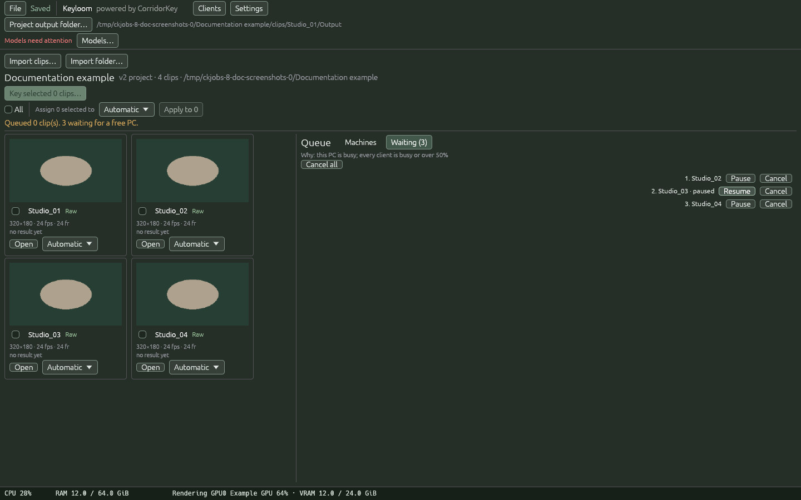

*Isolated example: Studio_03 is paused; Studio_02 and Studio_04 remain eligible.*

**Waiting (N)** lists confirmed **Automatic** shots that do not have a PC yet. Each free PC takes one eligible shot, then takes another when it finishes; the batch is not divided between PCs in advance. The **Why:** line explains why work is still waiting. Network PCs need their **Keyloom app running**, plus **Connect** and **Accept work** enabled; daemon-only discoverability is not enough. Automatic requires fresh GPU readings with both GPU utilization and VRAM usage below 50%.

- **Pause** keeps a shot in the list but prevents assignment. Other eligible shots can proceed.
- **Resume** makes it eligible again. These controls do not pause or resume an already-running job.
- **Cancel** removes one waiting shot. **Cancel all** removes every waiting shot, including paused shots, without cancelling work already assigned.
- A failed Automatic shot returns to the end of the list for another suitable PC. It does not retry a PC where it already failed in this session, and stays waiting if none remains suitable.

An explicitly assigned shot keeps its chosen destination. Running network jobs are not reassigned while their receiver may still be writing. See [queue details](network-rendering.md#6-watch-the-batch-queue) for network recovery.

## 10. Settings

**Settings** (top bar). Categories on the left; **Apply settings** saves, **Cancel** discards, **Reset defaults** restores.

- **Playback:** decoded-frame RAM budget (0 = Auto), decode workers, default looping.
- **Interface:** UI scale, and [background running](#background-running).
- **AI defaults:** starting values for new clips (VRAM profile, hint mode, temporal awareness, hint and despill strength, linear input). Choices already made on a project or clip are not replaced.
- **Path mapping:** how shared storage is named on this computer, for network rendering ([details](network-rendering.md#4-map-shared-storage-on-each-pc)).

  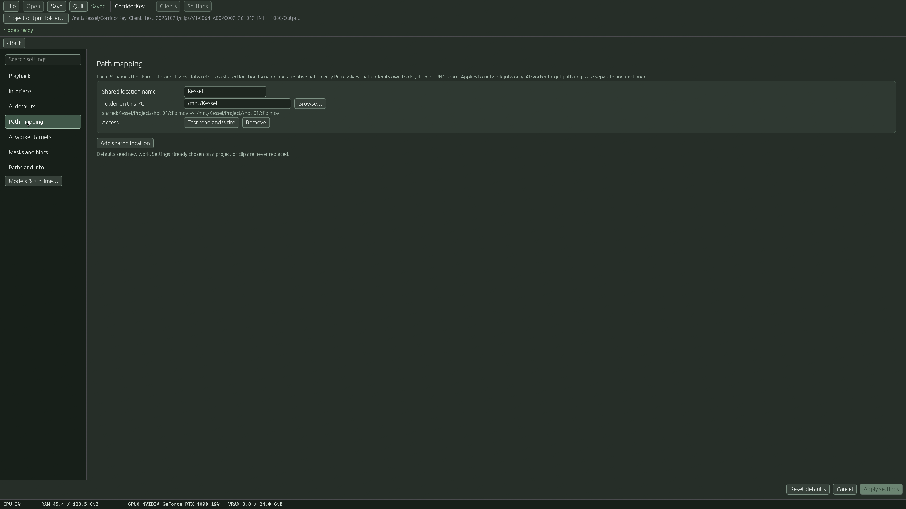
- **AI worker targets:** a local checkout. Normal installs need nothing here; other PCs are used through **Clients** (top bar).
- **Masks and hints:** default SAM2 tracker model.
- **Paths and info:** read-only locations of preferences, runtime and Python.
- **Models & runtime…** button: see below.

### Background running

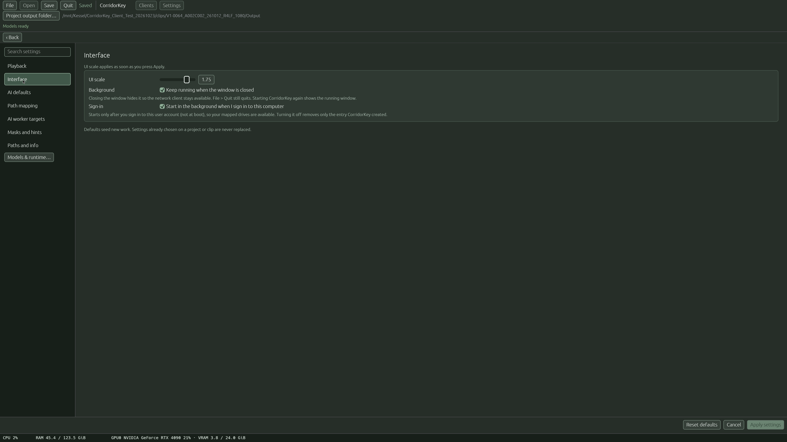

Under **Settings → Interface**:

- **Keep running when the window is closed** – closing the window hides Keyloom so the network client stays available. Starting Keyloom again just shows the running window (only one copy runs). **File → Quit** really quits.
- **Start in the background when I sign in to this computer** – starts hidden when *you* sign in (not at boot, no system service), so your mapped drives (for example `R:` or `Y:`) exist for the same user. Turning it off removes only the entry Keyloom created.

## Models

**Model weights are not bundled with the installers.** After installation, the model manager downloads selected models from their creators' published repositories/storage, or reuses verified existing files. **Each model's use is governed by its creator's licence and terms**, which can differ for code and weights. See the [creator attributions, download sources and notices](../README.md#model-creators-and-download-terms); Keyloom's licence does not grant additional model rights.

**Settings → Models & runtime…** (also **Models…** when the status bar says *Models need attention*) shows every model with its status. **Install full profile** downloads everything (large, resumable); **Install required models** the minimum; **Verify all** re-checks files; **Refresh status**; **Cancel operation**. Model changes are blocked while Key work is running; stop workers first.

## Keyboard shortcuts

| Key | Action |
|---|---|
| `B` | Back to the board |
| `1`–`5` | Media, Hint, Key, Review, Deliver |
| `G` | Show/hide the node graph |
| `F` | Focus the viewer |
| `P` | Properties (narrow windows) |
| `Space` | Play/pause |
| `←` `→` | Step one frame (`Shift` = 10) |
| `Home` `End` | First/last frame |
| `I` `O` | Set In / Set Out |
| `L` | Loop In/Out |
| `0` | Fit |
| `Esc` | Leave focus mode or a sheet |
| `Ctrl+O` `Ctrl+S` `Ctrl+Q` | Open, Save, Quit |

Shortcuts are ignored while you are typing in a field.
